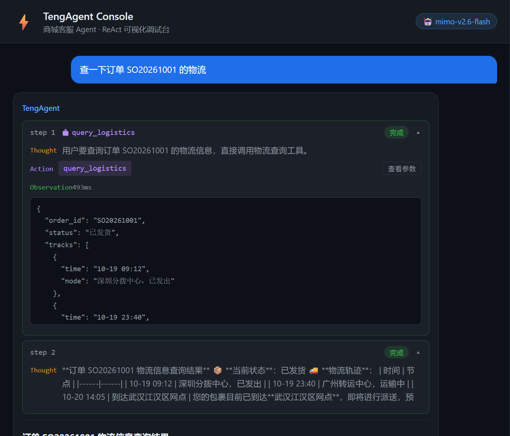
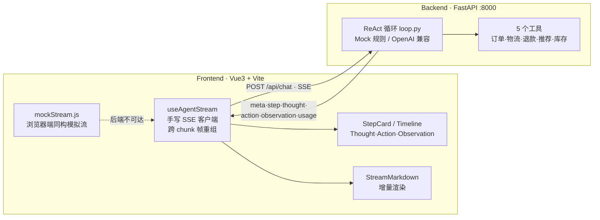

# ⚡ TengAgent Console

**Agent 可视化调试台** — 实时拆解 ReAct 推理链路：Thought 流式推理 → 工具调用 → Observation 观测 → 最终回答，全链路可观测。

> 为 AI 前端开发面试打造的全栈作品：后端 ReAct 循环用 Python 实现，前端可视化从零设计。

[](https://github.com/chaiwei-art/teng-agent-console/actions/workflows/ci.yml)
[](https://github.com/chaiwei-art/teng-agent-console/actions/workflows/pages.yml)


## 🖥 在线 Demo

**👉 [chaiwei-art.github.io/teng-agent-console](https://chaiwei-art.github.io/teng-agent-console)**（无需任何后端）

在线版自动探测后端可用性：后端可达 → 走真实 LLM / 本地 Mock；后端不可达（GitHub Pages）→ **浏览器端同构模拟流**，事件协议与 FastAPI 后端完全一致，交互体验零分叉。

## 📸 效果



*真实模型（mimo-v2.6-flash）驱动：Thought 逐字流出 → `query_logistics` 调用（含参数与 493ms 耗时的观测 JSON）→ 回答流式渲染，每步状态实时更新。*

## 🎯 为什么做这个

Agent 落地最大的障碍是**黑盒问题**：用户和开发者都不知道它为什么调这个工具、卡在哪一步、花了多少 token。本项目把 Agent 的每次推理过程端到端可视化。

## ✨ 功能

| 面板 | 能力 |
|------|------|
| 💬 对话 | SSE 流式对话，手写增量 Markdown 渲染（代码块未闭合锁定、表格防闪烁） |
| 🧠 链路 | ReAct 时间线：Thought（逐 token 打字机）→ Action（工具名 + 参数）→ Observation（结果 + 耗时） |
| 📊 Token | 每步 prompt/completion token 瀑布图，总耗时统计 |
| 🗂 记忆 | 会话上下文窗口可视化：每条消息 token 占用、保留策略一目了然 |
| 🛟 降级 | 真实 LLM 失败 → Mock 引擎；后端不可达 → 浏览器端模拟流，demo 永不白屏 |

## 🏗 架构



### 事件协议

```
meta          → { model, mode, max_steps }     mode: real | mock | local | fallback
step_start    → { step }
thought_delta → { step, text }                 # 流式逐 token
action_start  → { step, action, args }
observation   → { step, tool, result, duration_ms }
answer_delta  → { text }
usage         → { prompt_tokens, completion_tokens, total_tokens, latency_ms }
fallback      → { reason, to }                 # 真实模型失败降级
done          → {}
```

## 🚀 运行

### 方式一：在线（零依赖）

打开 [GitHub Pages](https://chaiwei-art.github.io/teng-agent-console)，即开即用（浏览器端模拟流）。

### 方式二：本地全栈

```bash
# 后端
cd backend
python -m venv .venv && .venv\Scripts\pip install -r requirements.txt   # macOS/Linux: source .venv/bin/activate
python -m uvicorn server:app --port 8000

# 前端（另开终端）
cd frontend
npm install
npm run dev        # http://localhost:5173（已代理 /api → :8000）
```

### 可选：接入真实模型

默认 **Mock 规则引擎**（无需 Key）。设置环境变量后切换真实 LLM，失败自动降级：

```bash
setx OPENAI_API_KEY sk-xxx
setx OPENAI_BASE_URL https://your-gateway/v1   # 可选，OpenAI 兼容网关
setx AGENT_MODEL gpt-4o-mini                    # 可选
```

## 🧪 测试

```bash
# 后端 28 例：工具边界 / ReAct 事件序列 / 模型输出解析回归 / SSE 端点
cd backend && pip install -r requirements-dev.txt && pytest tests -q

# 前端 12 例：SSE 单帧解析 / 跨 chunk 帧重组（半帧·多帧·逐字符·CRLF）
cd frontend && npm test
```

> 💬 `parse_react_text` 的回归用例来自真实接入排查：模型输出 `**Thought**:` 粗体标签、`Action Input:` 换行格式、缺少 `Answer:` 标签等边界都固化成了测试。

## 🧩 内置工具

| 工具 | 说明 |
|------|------|
| `query_order` | 查询订单基本信息 |
| `query_logistics` | 查询物流轨迹 |
| `search_products` | 搜索商品（关键词/品类） |
| `calculate_refund` | 按退款政策计算可退金额 |
| `get_inventory` | 查询库存 |

试试这些问题：

- `查一下订单 SO20261001 的物流`
- `订单 SO20261001 能退多少？`
- `推荐一款耳机`

## 🔧 技术亮点（面试可讲）

1. **手写 SSE 客户端**：基于 `fetch` + `ReadableStream`，帧重组器维护跨 chunk 缓冲（网络分包可能切在任意字节处），CRLF 归一化，均有单测固化。
2. **增量 Markdown 渲染**：未闭合 ``` 围栏锁定为 `<pre>` 防止整篇错乱；表格行未写完暂缓渲染，避免逐帧闪烁。
3. **三层降级韧性**：真实 LLM 异常 → `fallback` 事件回退 Mock 引擎；后端不可达 → 浏览器端同构模拟流；保证任何环境 demo 可用。
4. **真实接入反哺工程**：mimo 网关的粗体标签、无 Answer 标签等输出差异，全部沉淀为 `parse_react_text` 的回归测试。
5. **零 UI 依赖**：图表、时间线、记忆视图全部手写，产物 gzip 后约 35 KB。

## 📁 目录结构

```
teng-agent-console/
├── backend/
│   ├── server.py            # FastAPI + SSE 端点
│   ├── requirements.txt / requirements-dev.txt
│   ├── tests/               # pytest 28 例
│   └── agent/
│       ├── loop.py          # ReAct 循环 / Mock LLM / OpenAI 兼容 / parse_react_text
│       └── tools.py         # 工具注册表 + Mock 商城数据
├── frontend/
│   ├── src/
│   │   ├── App.vue          # 主界面（对话 + 观测面板）
│   │   ├── composables/
│   │   │   ├── useAgentStream.js   # 手写 SSE（帧重组 + 后端探测降级）
│   │   │   └── __tests__/          # vitest 12 例
│   │   ├── lib/mockStream.js       # 浏览器端同构模拟流
│   │   └── components/             # StepCard·Timeline·TokenWaterfall·MemoryView…
│   └── vite.config.js
└── .github/workflows/       # CI（测试+构建）/ Pages 部署
```

## License

MIT
